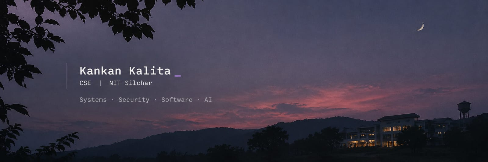

  

<h1 align="center">Hey, I'm Kankan 👋</h1>

  Computer Science Undergraduate · NIT Silchar

  

---

About me

I'm a CSE student interested in understanding how technology works beneath the surface and building useful things with it.

- Exploring systems programming, cybersecurity and networking
- Interested in AI, agent engineering and developer tools
- Enjoy working with Linux and open-source software
- Learning through experiments, side projects and problem-solving

I believe in building, breaking, understanding, and building better.

Tech stack

  

Selected projects

Project| Description
"NetSpecter" (https://github.com/kankan223/NetSpecter)| Python toolkit for networking, system monitoring and security utilities  
"ECO Website" (https://github.com/kankan223/ECO-Website)| Website for a student club  
"OMNIS" (https://github.com/kankan223/OMNIS)| Agent engineering and automation

More experiments and projects can be found in my "repositories" (https://github.com/kankan223?tab=repositories).

---

GitHub activity

  <!-- 
   -->

  
  

  <!-- 

Contribution graph -->

<h2 align="center">GitHub Metrics</h2>

  

<h2 align="center">Top Languages</h2>

  

<h2 align="center">Contribution Snake</h2>

  <picture>
    <source media="(prefers-color-scheme: dark)"
      srcset="https://raw.githubusercontent.com/kankan223/kankan223/output/github-contribution-grid-snake-dark.svg" />
    <source media="(prefers-color-scheme: light)"
      srcset="https://raw.githubusercontent.com/kankan223/kankan223/output/github-contribution-grid-snake.svg" />
    
  </picture>

---

  <i>Still learning. Still building. Always curious.</i>

  <a href="https://github.com/kankan223">GitHub</a>
  ·
  <a href="https://github.com/kankan223?tab=repositories">Projects</a>

